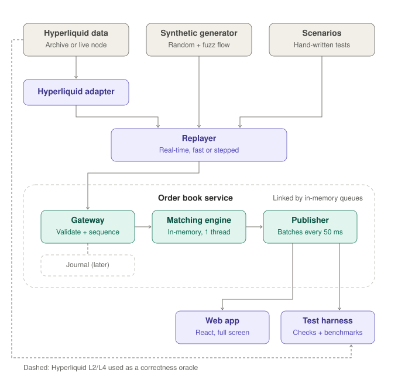
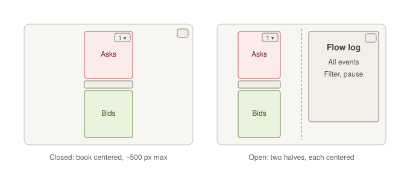

# orderbook

An exchange-style order book service and matching engine for a single market (BTC-USD), driven by order flow derived from Hyperliquid data. A full-screen web UI visualizes the live book and a log of the events that produced it. The project mirrors how real venues are built and documents where it deliberately does not.

> Early stage: the protocol, the matching crate, a live feed driven by random-walk order flow through the gateway and the matcher, and the web UI exist so far. See [Status](#status).

## Architecture

<picture>
  <source media="(prefers-color-scheme: dark)" srcset="docs/architecture-dark.svg">
  
</picture>

The diagram shows the target design. Principles:

- **Own protocol, adapters at the edge.** Every external source is translated into `crates/protocol` by an adapter. The engine only speaks this protocol, so swapping archived data for a live node means a new adapter and no engine change.
- **Single-threaded, deterministic engine.** One dedicated OS thread, in memory, price-time priority, no locks or database in the hot path beyond the synchronization inside its bounded queues. The same command sequence always produces the same event sequence; timestamps come from the input stream, never from a clock.
- **Integers for money.** Prices are ticks (`i64`), quantities are lots (`u64`). Decimals appear only at display time.
- **Publisher batching with snapshot and sequenced diffs.** The publisher keeps its own aggregated copy of the book and sends one combined diff every 100 ms. New clients receive a snapshot first; every message carries a sequence number, so clients detect gaps and resync from a snapshot. After about a second without any message the publisher sends a heartbeat that repeats the latest sequence number without advancing it. A client that hears nothing for 3.5 seconds (three missed heartbeats plus half an interval of slack), or gets no first message within 10 seconds of connecting, treats the connection as dead and reconnects with a fresh snapshot.
- **Bounded queues only.** The engine's sole link to the networked side (Tokio, Axum) is bounded in-memory queues. When its output queue is full it waits for the publisher to catch up (backpressure) and never drops an event.

## Web UI

<picture>
  <source media="(prefers-color-scheme: dark)" srcset="docs/ui-layout-dark.svg">
  
</picture>

Desktop only, in the dense style of a professional exchange order book. The book fills the browser height; a toggle opens the flow log beside it, with filtering and pause. The log is ready to show rejected orders and refused cancels and replaces; the random-walk order flow never provokes them. The feed is the source of truth for book state: the UI applies snapshots and diffs by sequence number and never derives the book from the event log.

## Status

Stack: Rust (Cargo workspace, Tokio, Axum) and React with TypeScript. Browsers receive JSON over WebSocket. TypeScript types are generated from the Rust protocol crate with [ts-rs](https://github.com/Aleph-Alpha/ts-rs).

- [x] Cargo workspace and `protocol` crate: `OrderId`, `Seq`, `Price`, `Qty`, `Ts`, `Side`, `Envelope<T>`, engine `Command`s (`Place`, `Cancel`, `Replace`), engine `Event`s (`Accepted`, `Rejected`, `CancelRejected`, `Trade`, `Replaced`, `Canceled`, `L2Update`) and the market-data `FeedMessage` (`Snapshot`, `Update`, `Heartbeat`), with generated TypeScript types for the types the web client reads (not commands) checked in CI
- [x] Publisher and WebSocket feed (`orderbook` binary)
- [x] Web UI: full-height live order book with depth bars and a spread bar, and a sliding flow log with filter and pause
- [x] `matching` crate: order book (sorted price levels, FIFO queues) and matching of good-till-cancel, IOC and post-only limit orders and market orders with price-time priority, and cancel and replace of resting orders
- [x] Hand-written deterministic scenarios in `scenarios/`, run by `cargo test -p matching`
- [x] The `matching` crate runs alone on its own engine thread, driven by random-walk order flow from the source thread through a bounded command queue
- [x] Gateway that validates and sequences commands in front of the engine thread: checks that need no book state (bounds of order size, price and order id, and order id reuse), then gap-free command sequence numbers
- [ ] Fuzz generator, invariant checks and benchmarks
  - [x] `generator` crate: seeded fuzz order flow (all time-in-force values, market orders, cancels and replaces of live, stale and unknown ids) that stays inside the gateway's bounds, checked against the matcher in its tests
  - [x] `harness` crate: structural invariants (book structure, event consistency, the feed's levels matching the book) checked after every command of 50 seeded fuzz runs of 2,000 commands, plus a determinism check. They catch an inconsistent book or feed, not a consistent but wrong one; the reference model below checks the outcomes
  - [x] Reference model: a naive second matcher in the `harness` crate, whose events its fuzz test compares with the real matcher's exactly. It shares no code with the matcher, but it could share a misreading of the docs
  - [x] Benchmark: `cargo run -p harness --release --bin bench` measures throughput and cancel cost (results under the price-levels trade-off)
  - [ ] Re-measure level lengths and cancel cost on replayed Hyperliquid data; switch levels to an index-based linked list if real levels get long
  - [ ] Bound level totals: decide how a level total above 2^53 is prevented or published (see the trade-offs).
- [ ] Hyperliquid adapter and replayer
- [ ] Deployment to a small Hetzner server

## Getting started

The pinned toolchain (Rust 1.99.1, see `rust-toolchain.toml`) is installed automatically by [rustup](https://rustup.rs).

```bash
cargo test --workspace                   # also regenerates the TypeScript types in web/src/protocol/
cargo run -p engine --bin orderbook      # serves the live feed at ws://127.0.0.1:8080/ws
cargo run -p harness --release --bin bench   # matcher throughput and cancel cost; release build only, numbers depend on the machine
```

The generated TypeScript files are committed; do not edit them by hand.

To run the web UI against the feed (Node 24, see `web/.nvmrc`, and pnpm):

```bash
pnpm -C web install
pnpm -C web dev                          # http://localhost:5173, /ws is proxied to the feed server
```

| Variable         | Default          | Meaning                                                      |
|------------------|------------------|--------------------------------------------------------------|
| `ORDERBOOK_ADDR` | `127.0.0.1:8080` | Listen address                                               |
| `ORDERBOOK_SEED` | clock-derived    | Seed of the random-walk order flow; the same seed gives the same command and event streams |
| `RUST_LOG`       | `info`           | Log filter                                                   |

## Repository layout

```
crates/protocol/   shared message format; source of the TypeScript types
crates/matching/   order book, limit- and market-order matching, cancel and replace: price levels with FIFO queues; no async or network crates, depends only on protocol (plus compile-time thiserror)
crates/engine/     order book service: random-walk order flow, gateway, matcher on its own thread, publisher, WebSocket feed
crates/generator/  seeded fuzz order flow, adversarial yet within the gateway's bounds; depends only on protocol (plus rand and rand_chacha)
crates/harness/    invariant checks and a naive reference matcher; its fuzz test runs generated flow through both matchers and compares their events exactly; depends on protocol and matching (plus generator in its tests)
web/               React frontend; src/protocol/ holds the generated TypeScript types
scenarios/         hand-written deterministic test cases (JSON), run by the matching crate's tests
docs/              diagrams
```

Planned, not yet present: `crates/adapters`, `crates/replayer` and `data/` (recorded sessions, gitignored).

## Trade-offs vs. production exchanges

- **Replication:** a single engine instance. Production runs several identical replicas kept in sync by a consensus protocol such as Raft, for instant failover.
- **Persistence:** no journal or snapshots; state is lost on restart. Production journals every input and snapshots the book for fast recovery.
- **Markets:** one market (BTC-USD). Production shards many markets across engines, each on a pinned CPU core.
- **Gateways:** one simple gateway whose checks need no book state. Production runs many gateways with authentication, rate limits and risk checks, feeding a central sequencer.
- **Gateway rejects:** a rejected command is logged on the submitting thread and never reaches the event stream or the public feed; production gateways answer the sender privately. The set of used order ids grows until restart; production venues scope ids to a trading day.
- **Sequence gaps:** a command whose sequence number is not the next one stops the engine with a panic, and the service with it. Production engines request missing input from the sequencer's journal on a gap and drop a repeated number as a duplicate, then carry on.
- **Accounts and risk:** no balances, margin or pre-trade risk checks.
- **Market data:** JSON over WebSocket, batched (100 ms). Production also offers binary feeds (e.g. SBE, multicast) for professional clients, and per-order (market-by-order) feeds. This feed is level-based only: aggregated quantity per price.
- **Level totals:** nothing bounds a level's total quantity. Above 2^53 lots, which takes about 90 million maximum-size orders at one price, JavaScript clients would read it inexactly; the matcher only stops, with a panic, at the far larger `u64` limit. Production venues cap open orders per account and publish sizes as decimal strings or binary integers.
- **Price levels:** each level is a `VecDeque` FIFO, so canceling inside a level is linear in its length. An index-based linked list gives O(1) cancel. Measured on an Apple M3 Max (release build, 2026-10-20): the matcher handles about 8.6 million fuzz commands per second (about 117 ns each); a cancel at the front of a level stays near 35 ns, while one in the middle costs about 250 ns with 1,000 orders at the price, 1.9 µs with 10,000 and 21 µs with 100,000. At the level lengths expected in practice this is the cost of one ordinary command, so the simpler structure stays until replayed data shows longer levels.
- **Price protection:** market orders have no protection, so on a thin book one can sweep far through the levels. Production venues add price bands or protection limits. Limit prices have no bands either: the gateway only checks that a price is positive and below 2^53, while production venues reject limit prices too far from a reference price, which needs book state.
- **Order types:** market orders trade immediately at any price, cancel any remainder and are rejected on an empty opposite side. Limit orders support GTC, IOC and post-only (a post-only order that would cross is rejected, never re-priced). A replace that changes the price or grows the quantity is a cancel followed by a new arrival: it loses time priority, and if the new price crosses it trades, except that a post-only order is refused instead. The `qty` of a replace is the new open quantity, not the total order size including fills; production venues differ on this. There is no fill-or-kill, stop or iceberg.
- **Cancel rejects:** `unknown_order` also covers "too late to cancel" (the order already filled or was canceled), which production venues report separately. Telling the two apart needs a record of past order ids in the engine, which answers cancels; the gateway keeps such a record but never sees whether an order filled.
- **Order flow:** a seeded random walk generates the commands: GTC limits around the touch, cancels, replaces and IOC takers that never exceed the touch, which the real matcher turns into events. It therefore never produces a `Canceled` IOC remainder or a reject.
- **Slow consumers:** a client that falls behind the broadcast buffer or stalls a send for over a second is disconnected and resyncs from a fresh snapshot. There is no per-client replay of missed updates.
- **Dead clients:** the server drops a vanished client once its writes, at least one per second, back up and hit the send timeout, typically within tens of seconds. Production servers also send WebSocket pings to detect them within a fixed interval.
- **Flow log:** the web UI keeps only the most recent events; production terminals offer a searchable history.
- **Infrastructure:** a small shared-vCPU cloud server. Production uses dedicated hardware, often co-located, with tuned networking.
